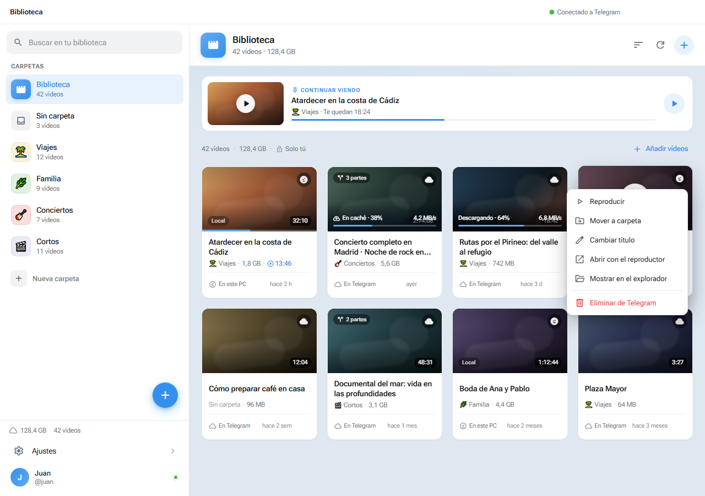

# TelePlayer

Reproductor de vídeo de escritorio para Windows que usa un canal privado de Telegram como videoteca personal. Interfaz en español, streaming progresivo y caché local.



> Proyecto personal y no oficial. No está afiliado a Telegram.

## Funciones

- Biblioteca en cuadrícula con carpetas, búsqueda, orden y «Continuar viendo».
- Importación de vídeos a un canal privado de tu propia cuenta de Telegram.
- Streaming progresivo: puedes empezar a ver sin descargar el archivo completo.
- Caché local reutilizable y descarga completa opcional.
- Reproductor con velocidad de 0.5× a 2×, PiP, pantalla completa y atajos de teclado.
- Archivos grandes divididos en partes según el límite de Telegram (2 GB, o 4 GB con Premium).
- Sesión y `api_hash` cifrados con DPAPI (`safeStorage`) en Windows cuando está disponible.
- Tema claro, oscuro o del sistema, con color de acento configurable.

## Requisitos

- Windows 10 u 11 de 64 bits.
- Una cuenta de Telegram.
- Credenciales API propias de Telegram (`api_id` y `api_hash`).
- Node.js 20.19 o superior y npm para ejecutar desde el código.

## Descargar

Descarga el instalador desde [GitHub Releases](https://github.com/EtherealDevv/teleplayer/releases/latest). No está firmado digitalmente, así que Windows SmartScreen puede mostrar una advertencia.

## Ejecutar desde el código

```powershell
npm install
npm run dev
```

Para comprobar tipos y generar el instalador:

```powershell
npm run typecheck
npm run dist
```

El instalador queda en `dist/TelePlayer-Setup-<versión>.exe`.

## Configurar Telegram

1. Entra en [my.telegram.org](https://my.telegram.org) y abre **API development tools**.
2. Crea una aplicación con el nombre que quieras y plataforma **Desktop**.
3. Copia el **App api_id** y el **App api_hash**.
4. Pega ambos valores en TelePlayer y sigue las instrucciones para iniciar sesión.
5. En la primera conexión se crea el canal privado **TelePlayer · Videoteca**.

TelePlayer solo se conecta a Telegram. No hay servidores propios de TelePlayer ni se envían datos a terceros. El canal es privado, pero no tiene cifrado de extremo a extremo: Telegram posee las claves del contenido almacenado en la nube.

## Uso

Pulsa **Añadir vídeos** para importar archivos. Al abrir un vídeo, la app descarga bajo demanda los bloques que necesita y los guarda en la caché local. Si el vídeo se completa, queda disponible para futuras reproducciones.

La velocidad de reproducción se cambia con el botón **1×** del reproductor. La app recuerda la última velocidad elegida. En conexiones lentas, bajar la velocidad reduce el ancho de banda necesario.

Atajos principales:

- `Espacio`: pausar o reanudar.
- `←` / `→`: retroceder o avanzar 10 segundos.
- `-` / `+`: bajar o subir la velocidad.
- `F`: pantalla completa.
- `M`: silenciar.
- `Esc`: cerrar el reproductor.

## Datos locales

En Windows, los datos se guardan en `%APPDATA%\teleplayer\`:

```text
teleplayer.json          # ajustes, sesión cifrada, progreso y caché
cache\videos\            # copias completas y bloques parciales
cache\thumbs\            # miniaturas
```

Los bloques parciales del streaming se conservan mientras la app está abierta. Las descargas completas permanecen hasta que las borres o se supere el límite de caché configurado. Cerrar sesión vacía la caché local, pero no borra nada de Telegram.

## Limitaciones

- La biblioteca lee los últimos 1500 mensajes del canal.
- Los formatos que Chromium no puede reproducir se pueden abrir con otro reproductor del sistema.
- No hay transcodificación ni cambio de calidad.
- Si cierras la app durante una importación pueden quedar mensajes parciales en el canal.
- El instalador no está firmado y no hay actualizaciones automáticas.
- Una sola cuenta y un solo canal por instalación.

## Licencia

MIT.
